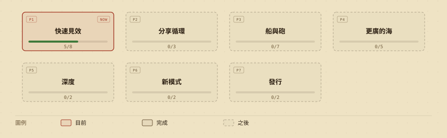
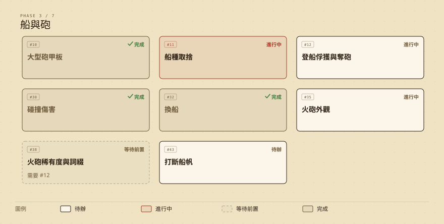

# Privateers 私掠者

一款俯視角的海盜海戰遊戲。轉動船身讓瞄準線對準敵船，打一輪舷側齊射，撿起戰利品帶回港口賣掉，再換更大的船、更好的砲，往更深、更危險的海域推進。拿下五張私掠許可狀上的懸賞，最後在大漩渦擊沉海軍上將的君權號。

A top-down pirate naval battle game. Turn your ship to lay the aim lines on an enemy, fire a rolling broadside, scoop up the plunder and sell it in port, then buy bigger ships and better guns and push into deeper, deadlier seas. Clear the five Letters of Marque and sink the Admiral's HMS *Sovereign* in the Maelstrom.

用 [Phaser 3](https://phaser.io/) 製作。不需要安裝或建置，所有圖形都用程式繪製，所有音效和音樂都用 Web Audio 即時合成，沒有任何外部素材。唯一的例外是根目錄的 `og.png`（分享連結時顯示的 1200×630 預覽圖）：爬蟲不會執行 JavaScript，所以用遊戲自己的繪圖程式（`tools/og.html`）畫好、再用 Playwright 截圖存成檔案，`npm run og` 可以重新產生。

**▶ 線上試玩 / Play online：<https://howwmingnew.github.io/Privateers/>**

也可以把專案下載下來，直接用瀏覽器打開 `index.html`。

## 遊戲內容

- **戰役**：五張懸賞，各有一位有名有姓的船長和護衛艦隊，打完會升階級、解鎖新船，最後一張觸發結局。通關後可以繼續自由航行，或開始新遊戲+（敵人更強、戰利品更多、保留火砲）。
- **四片海域**：淺灘、暗礁海峽、海軍航道、大漩渦，敵人等級 1–10，離港口越遠越富有也越危險。外海有一座解鎖後可以賣貨、修船的前哨站。
- **船與火砲**：五種可購買的船（單桅帆船到戰列艦），有船首、舷側和船尾砲位；多種火砲可以購買、升級、自由配置。換船時船體、船帆、貨艙的升級從 Lv 1 重新開始。
- **勢力**：海盜攻擊所有人，海軍追捕海盜和你，商船逃跑。AI 之間也會互打，殘骸裡的戰利品誰都能撿。
- **殘骸**：你的船沉了，貨物會留在沉沒處（地圖上的紅色 ✕），關掉遊戲也會保留，可以回去撈。
- **其他**：首航互動教學、航海日誌與統計、20 個成就、標題畫面、暫停選單、設定（音量、語言、畫面震動、文字大小、全螢幕）、繁體中文 / English。

## 操作

| 裝置 | 操作 |
|---|---|
| 鍵盤 | `A` `D` / `←` `→` 轉向；`W` `S` / `↑` `↓` 升降船帆，船會維持速度；`空白鍵` 開火；`Esc` / `P` 暫停；`M` 靜音；`H` 拍照模式 |
| 滑鼠 | 按住左鍵往游標方向航行（離船越遠帆越滿），放開或快速點一下開火；滾輪縮放 |
| 觸控 | 任意位置拖曳出浮動搖桿轉向，放開開火；`❚❚` 暫停 |
| 控制器 | 左搖桿轉向，十字鍵升降船帆，`A` / `RT` 開火，`Start` 暫停，選單中十字鍵移動、`A` 確認、`B` 返回 |

瞄準線顏色：紅色＝現在開火會打中，黃色＝會打空，淡白色＝裝填中。敵船標籤的顏色和符號（▼ ● ▲ ▲▲）表示它和你的船艦等級相比有多危險。

## 更新路線圖 / Roadmap

接下來要做的新功能分成幾個階段，一次聚焦一個階段。下面兩張圖會在 GitHub issue 變動時自動重畫；遊戲標題選單的「更新路線圖」可以看到即時版本，也能切換各階段。

What's coming next, one phase at a time. These images redraw themselves whenever an issue changes; the live, clickable version is under **Roadmap** on the title menu.

**▶ [查看更新路線圖 / Open the roadmap](https://howwmingnew.github.io/Privateers/roadmap/)**





## 開發

```bash
npm install            # 只裝測試用的 Playwright（使用系統安裝的 Chrome，不另外下載瀏覽器）
npm run serve          # 在 http://127.0.0.1:8765 提供遊戲（手動玩用；測試自己會開伺服器，不需要這個）
npm test               # 單元 + 冒煙測試（CI 的必過關卡）
npm run test:quick     # 單元 + 冒煙 + 依 `git diff origin/main` 挑出的相關瀏覽器測試，目標 5 分鐘內
npm run test:all       # 全部測試；加 `-- --jobs 4` 平行跑
npm run fonts          # 重新產生 js/fonts-link.js（字型子集）
```

**測試怎麼加**：放一個檔案就好，不用改 `package.json`。`tests/unit*.mjs` 是單元測試（`node --test`）；`tests/<name>.mjs` 是瀏覽器測試，網址從 `argv[2]` 讀、失敗時以非 0 結束，`test:all` 會自動跑到。檔名以 `-perf` 結尾，或是 `art-perf`／`art-shots`／`art-page`，屬於效能與截圖工具，預設不跑，要手動執行。要讓 `test:quick` 認得新模組，在 `tools/test-map.mjs` 加一行對應（沒對應到的檔案會改跑核心測試組）。單支測試：`node tools/run-tests.mjs gundeck heat`。

`node tools/flake-check.mjs 5 shell heat --jobs 4` 把指定測試連跑 N 次並列出通過率（失敗輸出存在 `.review/flake/`），修不穩定測試時用。

`node tools/run-tests.mjs [unit|smoke|browser|quick|all|ci] [--jobs N] [--no-retry] [--list]`：每個 worker 自己開一個靜態伺服器和埠；失敗的測試會單獨重跑一次，重跑後通過會標示「重跑後通過」（不算失敗，但請去修那支測試）。

**開 PR 與合併 main 之後**：字型清單和測試清單不再是固定衝突點。
- 字型：`js/fonts-link.js` 是工具產生的單行檔案。遇到衝突就任選一邊，然後執行 `npm run fonts` 並 commit。CI 會跑 `node tools/font-subset.mjs --check`，清單過期時會明確報錯（不會自動改檔）。
- 測試：`package.json` 不再列測試檔，所以不會因為加測試而衝突。
- `index.html` 的 script 清單仍是共用清單；載入順序有語意，我沒有動它；新腳本請加在依賴它的腳本旁邊，不要每個 PR 都接在檔尾同一處，衝突時兩行都保留即可（先確認順序）。

- Phaser 3.80.1 從 cdnjs 載入；程式是 `js/` 下的一般 `<script>`（不是 ES module），所以 `file://` 也能直接開。
- 存檔在瀏覽器的 localStorage（`privateers-save-v2`，舊版 v1 存檔會自動轉換）；設定另存在 `privateers-settings`。
- `npm run og` 重畫 `og.png`（需要網路：Phaser 和字型從 CDN 載入）。改了船的畫法或標題文案之後記得重跑。
- `tools/sound-test.html` 可以試聽所有音效和音樂，`tools/art-test.html` 可以檢視所有船型與塗裝。
- 更新路線圖：`roadmap/index.html` 讀取標記為 `enhancement` 的 GitHub issue。每個要上圖的 issue 開頭有一行隱藏註解 `<!-- roadmap: phase=3; en=English title; deps=10 -->`（階段、英文標題、前置 issue）；加上 `in progress` 標籤會顯示為「進行中」。`.github/workflows/roadmap.yml` 在 issue 變動時執行 `node tools/roadmap-build.mjs`，重畫 README 的圖和離線快照。
- 部署在 GitHub Pages，直接發布 `main` 分支根目錄；push 後約 1～2 分鐘自動更新。
